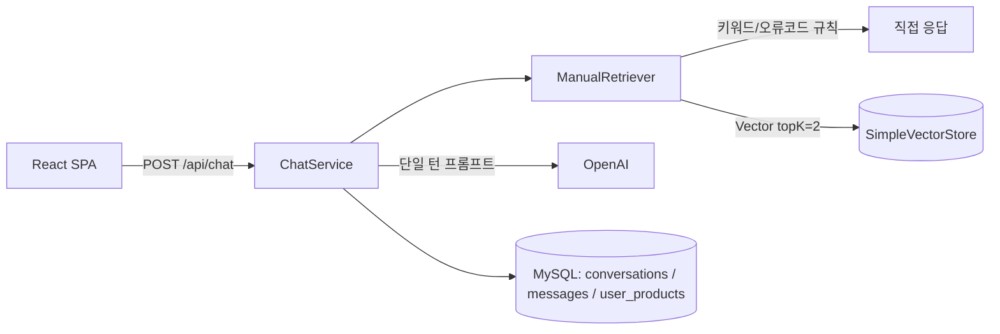
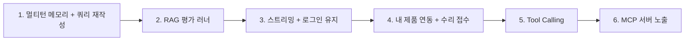

# HomeCare AI(core_project) 기능·MCP 추천 보고서

## 1. 현재 상태 요약

| 영역 | 구성 | 비고 |
| --- | --- | --- |
| Backend | Spring Boot 4.1 · Java 21 · Spring AI 2.0 (OpenAI) · JPA · Flyway · JWT | 인증 / 채팅 / 대화 기록 / 내 제품 CRUD |
| RAG | Markdown 매뉴얼 4종 → `SimpleVectorStore`(메모리) + 오류 코드 정규식 매칭 | 첫 요청 시점에 임베딩 생성(lazy) |
| Frontend | React 19 + Vite (라이브러리 의존성 없음) | Chat / MyPage / ProductDialog |
| Infra | Terraform(EC2, RDS MySQL, ECR, S3, CloudWatch) · GitHub Actions(OIDC → ECR → SSM) · Vercel · Nginx | 배포·롤백·백업 검증까지 잘 갖춰져 있음 |

> [!NOTE]
> 인프라·CI/CD·마이그레이션 쪽은 이미 완성도가 높습니다. 반면 **AI 상담 기능 자체**와 **사용자 경험**은 아직 MVP 단계라 추천은 대부분 이쪽에 집중했습니다.

---

## 2. 코드에서 발견한 개선 포인트 (기능 추가 전에 볼 것)

| # | 위치 | 내용 |
| --- | --- | --- |
| 1 | [ChatService.java:59-63](file:///Users/gwonu/project/core_project/backend/src/main/java/com/project/backend/chat/ChatService.java#L59-L63) | **이전 대화를 LLM에 전달하지 않음.** "그래도 안 돼요", "2번은 어떻게 해요?" 같은 후속 질문의 맥락을 잃음. 검색 쿼리도 현재 메시지만 사용 |
| 2 | [ManualRetriever.java:41-46](file:///Users/gwonu/project/core_project/backend/src/main/java/com/project/backend/rag/ManualRetriever.java#L41-L46) | 단순 `contains` 비교라서 식기세척기 상담 중 "**건조기**능이 약해요"라고 하면 '건조기' 제품을 언급한 것으로 오인해 응답을 거부함. "에어컨 옆 냉장고" 같은 문장도 차단됨 |
| 3 | [ManualRetriever.java:76](file:///Users/gwonu/project/core_project/backend/src/main/java/com/project/backend/rag/ManualRetriever.java#L76) | 인덱스를 첫 요청 때 만들기 때문에 배포 직후 첫 사용자가 임베딩 지연을 겪음. `synchronized` 때문에 동시에 들어온 요청도 같이 대기 |
| 4 | [App.jsx:8](file:///Users/gwonu/project/core_project/frontend/src/App.jsx#L8) | 세션을 메모리에만 저장하므로 **새로고침하면 로그아웃**됨. refresh token이 없음 |
| 5 | [ProductController.java](file:///Users/gwonu/project/core_project/backend/src/main/java/com/project/backend/product/ProductController.java) | 제품 **삭제 API가 없음**. 회원 탈퇴 기능도 없음(주소 등 개인정보를 저장하므로 필요) |
| 6 | `user_products` ↔ 채팅 | 등록한 제품(모델명, 구매일)이 상담에 전혀 쓰이지 않음 |
| 7 | [evaluation.jsonl](file:///Users/gwonu/project/core_project/backend/rag-test-data/evaluation.jsonl) | 평가셋 23건은 있지만 자동으로 실행하는 러너/CI 단계가 없음 |

---

## 3. 추천 기능 (우선순위별)

### P0 — 상담 품질에 바로 영향

**① 멀티턴 대화 메모리**
- Spring AI `MessageChatMemoryAdvisor`를 붙이고, 기존 `chat_messages` 테이블을 읽는 `ChatMemoryRepository`를 직접 구현합니다(새 테이블 불필요). 최근 N턴만 사용합니다.
- 검색 단계에는 `RewriteQueryTransformer`를 적용해 "그래도 안 돼요" 같은 질문을 대화 이력 기준의 독립된 질문으로 바꾼 뒤 검색합니다.

**② 스트리밍 응답(SSE)**
- `chatClient.prompt()...stream().content()`로 생성하고 `SseEmitter` 또는 `Flux<ServerSentEvent>`로 내려보냅니다. 프론트는 `fetch` + `ReadableStream`으로 받습니다.
- 현재 120초 타임아웃 동안 화면이 멈춰 있는 듯한 체감을 크게 줄일 수 있습니다.

**③ 내 제품 기반 상담 시작**
- 새 상담을 시작할 때 등록한 제품을 고르면 카테고리를 자동으로 정하고, 모델명·구매일을 컨텍스트로 넣습니다.
- `chat_conversations.product_id`(nullable FK) 컬럼을 추가하는 마이그레이션 `V003`이 필요합니다.

**④ 카테고리 판별 로직 개선**
- 하드코딩된 `contains` 규칙 대신 단어 경계 정규식과 예외 사전("건조기능", "건조 코스" 등)을 쓰거나, 저렴한 모델로 의도(제품) 분류를 한 번 거칩니다.

**⑤ RAG 자동 평가를 CI에 추가**
- **검색 평가**: `expected_document_ids` 기준 Recall@k를 측정합니다. LLM 호출 없이 임베딩만 쓰므로 비용이 적습니다.
- **답변 평가**: Spring AI `RelevancyEvaluator` / `FactCheckingEvaluator`나 LLM-as-judge로 `expected_points`를 채점합니다.
- 비용이 들기 때문에 `workflow_dispatch`나 프롬프트·매뉴얼 변경 시에만 실행하는 Gradle 태스크(`ragEval`)로 분리하는 것을 추천합니다.

### P1 — 사용자 경험 / 운영

| 기능 | 설명 |
| --- | --- |
| **로그인 유지 (Refresh Token)** | HttpOnly·Secure 쿠키로 refresh token을 발급하고 access token은 짧게 유지. `/api/auth/refresh` 추가 |
| **수리 접수(에스컬레이션) 티켓** | 매뉴얼마다 "상담 전환 기준"이 있으므로 답변에 [수리 접수] 버튼을 노출. 제품 + 주소(이미 `user_products`에 저장됨) + **LLM 대화 요약**으로 `repair_requests`를 생성 |
| **답변 피드백 👍/👎** | `message_feedback` 테이블에 저장. 👎 받은 답변은 평가셋 후보로 활용 |
| **오류 표시창 사진 인식** | 멀티모달 모델로 사진에서 `HC-E01` 같은 코드와 상태를 추출한 뒤 기존 검색 흐름으로 연결 |
| **근거 문서 미리보기 / Markdown 렌더링** | 출처 칩을 클릭하면 매뉴얼 섹션을 표시. 답변의 번호 목록·굵게 표시를 렌더링 |
| **인덱스 워밍업 / 영속화** | `ApplicationReadyEvent`에서 인덱스를 미리 생성. 매뉴얼 해시가 같으면 `SimpleVectorStore.save()` 파일을 재사용 |
| **사용량 제한 · 비용 가드** | Bucket4j로 사용자별 분당·일일 채팅 횟수 제한. Spring AI Observation으로 토큰 사용량 메트릭 수집 → CloudWatch |
| **제품 삭제 / 회원 탈퇴 / 비밀번호 변경** | 기본 계정·개인정보 관리 기능 |

### P2 — 확장

- **관리자 페이지**: `role` 컬럼은 이미 있습니다. 매뉴얼 업로드·버전 관리, 상담 통계, 👎 답변 검토 기능을 둡니다.
- **하이브리드 검색**: 키워드(BM25) + 벡터 검색을 섞고 재랭킹합니다. 매뉴얼이 늘어나면 pgvector나 OpenSearch로 이전합니다.
- **대화 제목 자동 생성**: 지금은 첫 메시지를 제목으로 씁니다.
- **E2E 테스트**: Playwright로 로그인 → 상담 → 기록 조회 흐름을 검증합니다.

---

## 4. MCP 추천

### 4-A. 개발 생산성용 MCP (에이전트·IDE에 연결)

| MCP 서버 | 이 프로젝트에서의 활용 | 우선순위 |
| --- | --- | --- |
| **GitHub MCP** (`github/github-mcp-server`) | Actions 실패 로그 분석, PR/이슈 관리. CI/CD가 핵심이라 효과가 큼 | ⭐⭐⭐ |
| **AWS MCP** (`awslabs` – CloudWatch Logs, AWS API) | `/homecare/runtime` 로그 조회, EC2·RDS·SSM 상태 점검. 현재 `ops/*.py`로 하던 확인 작업을 대화로 처리 | ⭐⭐⭐ |
| **Terraform MCP** (`hashicorp/terraform-mcp-server`) | AWS provider 6.x 리소스 문서와 모듈 조회. `terraform-aws-ec2` 수정 시 사용 | ⭐⭐ |
| **MySQL MCP** (읽기 전용 계정으로) | 로컬·테스트 DB 스키마와 데이터 조회. Flyway 마이그레이션 작성 보조 | ⭐⭐ |
| **Context7** | Spring Boot 4 · Spring AI 2.0 최신 API 문서 조회. 버전이 새로워 학습 데이터와 차이가 큼 | ⭐⭐⭐ |
| **Playwright MCP** | Vercel 배포본을 실제 브라우저로 조작해 UI 회귀 확인 | ⭐⭐ |
| **Vercel MCP** | 프론트 배포 상태와 빌드 로그 확인 | ⭐ |

> [!CAUTION]
> AWS / MySQL MCP는 반드시 **읽기 전용 IAM 역할과 DB 계정**으로 연결하세요. 운영 RDS에 쓰기 권한이 있는 MCP를 붙이면 에이전트 실수로 데이터가 손상될 수 있습니다.

### 4-B. 제품 기능으로서의 MCP (Spring AI MCP 지원 활용)

**① HomeCare를 MCP 서버로 노출** — `spring-ai-starter-mcp-server-webmvc`
- 기존 서비스를 그대로 감싸 Claude Desktop 같은 외부 AI 에이전트가 호출할 수 있게 합니다.

| Tool | 연결할 기존 코드 |
| --- | --- |
| `search_manual(category, query)` | `ManualRetriever.retrieve` |
| `lookup_error_code(category, code)` | `ManualCatalog` 오류 코드 필터 |
| `list_my_products()` | `ProductService.list` (JWT/OAuth 인증 필요) |
| `create_repair_request(...)` | 3장 P1의 수리 접수 기능 |

- 포트폴리오 관점에서도 "RAG 서비스를 MCP 표준으로 개방"했다는 점이 좋은 차별점이 됩니다.

**② 상담 에이전트에 Tool Calling 도입** — `@Tool` (MCP client 이전 단계)
- LLM이 상황에 따라 `getMyProduct`, `searchManual`, `createRepairRequest`를 직접 호출하도록 바꿉니다. 지금의 고정된 "검색 → 생성" 흐름이 에이전트형 흐름으로 바뀝니다.
- 이후 외부 시스템(실제 A/S 예약, 부품 재고)이 MCP 서버로 제공되면 `spring-ai-starter-mcp-client`로 연결만 바꾸면 됩니다.

> [!WARNING]
> Tool Calling을 도입하면 시스템 프롬프트의 "실제 예약 접수를 만들어 내지 마세요" 규칙과 충돌합니다. 수리 접수 도구를 추가할 때는 **사용자 확인 단계(confirm)**를 반드시 거치도록 설계하고 프롬프트도 함께 수정해야 합니다.

---

## 5. 추천 진행 순서

평가 러너(2)를 일찍 만들어 두면, 이후 프롬프트·검색·Tool Calling을 바꿀 때마다 품질 저하 여부를 수치로 확인할 수 있습니다.
